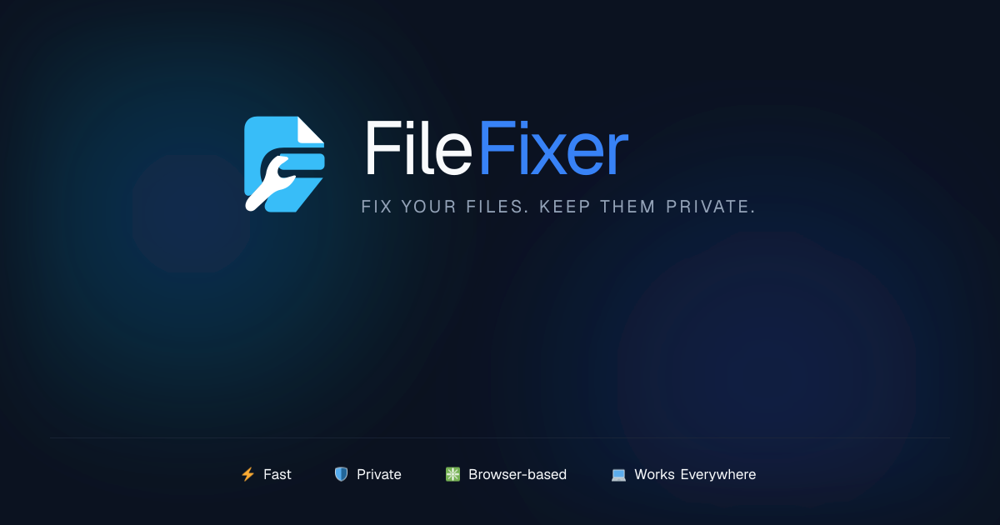

<div align="center">

  

  <br />

  <p><strong>Fix your files. Keep them private.</strong></p>

  <p>
    A high-performance, cinematic browser utility studio for images, PDFs, and files.<br />
    <strong>100% on-device processing. Zero server uploads. Absolute privacy.</strong>
  </p>

  <p>
    <a href="https://filefixer.vercel.app/"><strong>Explore Live Application »</strong></a>
  </p>

  <p>
    <a href="https://github.com/manishmeena513/FileFixer/actions/workflows/ci.yml">
      
    </a>
    
    
    
    
    
  </p>

</div>

---

## Table of Contents

- [Project Overview](#project-overview)
- [Key Features & Workstations](#key-features--workstations)
  - [Image Processing Suite](#1-image-processing-suite)
  - [PDF Workstation Suite](#2-pdf-workstation-suite)
  - [Batch & Workflow Automation](#3-batch--workflow-automation)
  - [Privacy & Inspection Tools](#4-privacy--inspection-tools)
- [Product Preview](#product-preview)
- [Technology Stack](#technology-stack)
- [Getting Started Locally](#getting-started-locally)
- [Project Architecture & Structure](#project-architecture--structure)
- [Privacy & Security Guarantees](#privacy--security-guarantees)
- [Production Deployment](#production-deployment)
- [Testing & Quality Assurance](#testing--quality-assurance)
- [Contributing](#contributing)
- [License Status](#license-status)
- [Acknowledgments](#acknowledgments)

---

## Project Overview

**FileFixer** solves a critical modern dilemma: users frequently need to perform routine file operations—such as compressing high-resolution photos, extracting PDF pages, reordering contracts, converting formats, or stripping sensitive EXIF location metadata—but existing web tools require uploading confidential files to remote third-party cloud servers.

FileFixer eliminates cloud exposure entirely by performing **every single transformation directly inside the client's browser**:
- **Zero Server Uploads**: File contents, image pixels, and PDF streams never leave your physical device.
- **No Accounts or Subscriptions**: Immediate utility without account barriers, rate limits, or email sign-ups.
- **Offline & PWA Ready**: Installable as a Progressive Web App (PWA) with client-side caching via service workers.
- **Cinematic Glass Studio**: Premium desktop-grade interface engineered with fluid responsive design across mobile phones (320px–430px), tablets, and high-DPI desktop screens.

---

## Key Features & Workstations

FileFixer provides **20 dedicated client-side file tools** organized across four primary domains:

### 1. Image Processing Suite
- **Image Studio (`/image-studio`)**: Integrated digital darkroom with live aspect ratio cropping, 90° rotations, horizontal/vertical flips, CSS visual filters (brightness, contrast, saturation), and interactive before/after split sliders.
- **Smart Compress Under X MB (`/smart-compress`)**: Signature binary-search iterative compressor that automatically tunes quality parameters to hit strict file ceilings (e.g., `< 200 KB` or `< 500 KB` for job, visa, and passport applications).
- **Compress Image (`/compress-image`)**: High-speed lossy and lossless image compression for JPG, PNG, and WebP assets with live bandwidth savings telemetry.
- **Resize & Scale (`/resize-image`)**: Exact pixel scaling, percentage scaling, and standard display presets (1080p, 4K, social avatars) with aspect ratio constraints.
- **Convert Image (`/convert-image`)**: High-fidelity format conversion between JPG, PNG, and modern WebP formats.
- **Crop & Rotate (`/crop-image`)**: Aspect-constrained cropping with interactive touch handles and orientation adjustment.
- **EXIF & GPS Stripper (`/image-metadata`)**: Deep EXIF inspection with one-click sanitization of GPS coordinates, camera serial numbers, and creator tags.

### 2. PDF Workstation Suite
- **PDF Visual Workspace (`/pdf-workspace`)**: Visual page reordering canvas with drag-and-drop thumbnail sorting, per-page 90° rotation, page duplication, and page removal.
- **PDF Studio (`/pdf-studio`)**: Interactive multi-page document organizer with instant visual feedback and stream compaction.
- **Merge PDFs (`/pdf-merge`)**: Combine multiple independent PDF documents into a unified, cleanly indexed single document.
- **Split & Extract (`/pdf-split`)**: Flexible range parsing (e.g., `1-3, 5, 8-10`) to extract specific pages into standalone PDF documents.
- **Compress PDF (`/pdf-compress`)**: Compact unreferenced PDF objects, optimize internal streams, and strip heavy metadata dictionaries.
- **Images to PDF (`/images-to-pdf`)**: Convert image sequences into paginated PDF documents with standardized A4 and Letter margins.

### 3. Batch & Workflow Automation
- **Batch Processing Studio (`/batch`)**: Multi-pipeline bulk processor executing chained operations (Resize $\rightarrow$ Convert $\rightarrow$ Compress $\rightarrow$ Rename) across dozens of files simultaneously.
- **Sequential Bulk Rename (`/batch-rename`)**: Expression-based batch renaming with token substitution (`{name}`, `{ext}`, `{n}`, `{YYYY-MM-DD}`, `{width}x{height}`) and live before/after validation tables.
- **Visual Workflow Builder (`/workflows`)**: Preset multi-step pipelines (e.g., Passport ID Prep, E-Commerce Asset Standardization, Expense Receipt Archival).

### 4. Privacy & Inspection Tools
- **Privacy Cleaner (`/privacy-cleaner`)**: Comprehensive sanitization center to strip author dictionaries, IP tags, and GPS coordinates from documents and media.
- **File Inspector (`/inspect`)**: Deep structural inspection revealing true MIME types, binary byte lengths, magic bytes, and embedded tags.
- **On-Device History (`/history`)**: Local IndexedDB session log tracking cumulative bandwidth saved and files processed without external telemetry.

---

## Product Preview

<div align="center">
  
  <p><em>The FileFixer Digital Workspace — Modern, responsive, and completely private.</em></p>
</div>

---

## Technology Stack

FileFixer is built strictly with modern, production-grade web technologies:

| Category | Technology | Purpose |
|---|---|---|
| **Core Framework** | [Next.js 16.3.5 (App Router)](https://nextjs.org/) | Static site generation (SSG), file-system routing, and Turbopack bundler |
| **UI Library** | [React 19.2.8](https://react.dev/) | Component architecture and high-frequency concurrent state updates |
| **Language** | [TypeScript 5.x](https://www.typescriptlang.org/) | End-to-end type safety, strict interface contracts, and null-safety |
| **Styling & Design** | [Tailwind CSS v4](https://tailwindcss.com/) | High-performance CSS engine with custom cinematic glass design tokens |
| **UI Primitives** | [Radix UI](https://www.radix-ui.com/) | Accessible, unstyled primitives for dialogs, sliders, tabs, and switches |
| **Icons & Branding** | [Lucide React](https://lucide.dev/) | Clean, accessible vector icons with dynamic sizing |
| **PDF Processing** | [pdf-lib](https://pdf-lib.js.org/) & [pdfjs-dist](https://mozilla.github.io/pdf.js/) | In-browser PDF byte manipulation, page extraction, and rendering |
| **Image Compression** | [browser-image-compression](https://github.com/Donaldcwl/browser-image-compression) | Client-side Canvas/WebWorker image compression and WebP encoding |
| **Metadata Parsing** | [exifr](https://github.com/MikeKovarik/exifr) | Fast binary EXIF, TIFF, and GPS metadata extraction and sanitization |
| **Drag & Drop** | [@dnd-kit/core](https://dndkit.com/) | Accessible touch and pointer drag-and-drop for page reordering |
| **Image Cropping** | [react-image-crop](https://github.com/DominicTobias/react-image-crop) | Touch-responsive aspect-ratio image cropping canvas |
| **Archive Bundling** | [JSZip](https://stuk.github.io/jszip/) | Client-side ZIP creation for batch outputs |
| **Local Persistence** | [Zustand](https://github.com/pmndrs/zustand) & [idb](https://github.com/jakearchibald/idb) | Micro-state management and IndexedDB local history storage |
| **Test Runner** | Node.js 22 Test Runner (`tsx`) | Opaque-box 4-tier requirement and invariant test suite |
| **Deployment** | [Vercel](https://vercel.com/) | Global Edge network delivery with static route pre-rendering |

---

## Getting Started Locally

### Prerequisites
- **Node.js**: `v20.x` or `v22.x+` installed.
- **npm**: `v10+` installed.

### Installation & Run

1. **Clone the repository:**
   ```bash
   git clone https://github.com/manishmeena513/FileFixer.git
   cd FileFixer
   ```

2. **Navigate to the application workspace:**
   ```bash
   cd filefixer
   ```

3. **Install dependencies:**
   ```bash
   npm install
   ```

4. **Launch the development server:**
   ```bash
   npm run dev
   ```

5. **Open your browser:**
   Navigate to [http://localhost:3000](http://localhost:3000).

### Available Commands

All commands should be executed from within the `filefixer/` directory:

```bash
# Start local dev server with Turbopack
npm run dev

# Run complete 4-tier automated test suite (421 tests)
npm test

# Build production static application (33 static routes)
npm run build

# Start local production server
npm run start

# Run ESLint validation
npm run lint
```

---

## Project Architecture & Structure

```text
FileFixer/
├── .github/                        # GitHub CI/CD, issue & PR templates
│   ├── workflows/ci.yml            # Automated CI verification workflow
│   ├── ISSUE_TEMPLATE/             # Standardized bug & feature issue forms
│   └── PULL_REQUEST_TEMPLATE.md    # Pull request quality checklist
├── docs/                           # Comprehensive technical documentation
│   ├── architecture.md             # In-depth system design & privacy model
│   ├── development.md              # Local engineering & coding guidelines
│   ├── deployment.md               # Vercel static deployment specifications
│   └── testing.md                  # 4-tier testing matrix & invariant suites
├── filefixer/                      # Primary Next.js 16 App Router application
│   ├── public/                     # Static assets, branding, and PWA manifest
│   │   ├── branding/               # Vector logos, marks, and social preview assets
│   │   ├── icons/                  # PWA application icons (192px, 512px)
│   │   └── images/                 # Invariant support QR asset
│   ├── src/
│   │   ├── app/                    # 33 App Router pages, layouts, and SEO routes
│   │   ├── components/             # React UI components, navigation, modals, and tools
│   │   ├── lib/                    # 100% on-device image, PDF, and batch engines
│   │   ├── stores/                 # Zustand global reactive state
│   │   └── types/                  # TypeScript interface contracts
│   ├── tests/                      # 421 requirement & adversarial test cases
│   ├── package.json                # Application dependencies and scripts
│   ├── tailwind.config.ts          # Tailwind styling configuration
│   └── tsconfig.json               # TypeScript compiler configuration
├── .editorconfig                   # Cross-IDE indentation and formatting
├── .gitattributes                  # LF line-ending normalization & binary locks
├── .gitignore                      # Clean repository ignore rules
├── CONTRIBUTING.md                 # Open-source contribution guidelines
├── README.md                       # Product documentation (this file)
└── SECURITY.md                     # Security policy & vulnerability reporting
```

---

## Privacy & Security Guarantees

FileFixer was founded on the belief that utility tools should not require sacrificing privacy:

- **100% In-Browser Execution**: All processing algorithms run via client-side JavaScript, WebAssembly, and Web Workers.
- **Zero Remote Endpoints**: The application contains strictly zero server API routes in `src/app/api`.
- **Zero Third-Party Trackers**: No analytics or session-recording trackers exist in the codebase.
- **Transient Memory**: Once a file is processed or dismissed, the browser's garbage collector releases the memory buffer.
- **Security Inquiries**: For details or responsible disclosure, please refer to our [Security Policy](SECURITY.md).

---

## Production Deployment

FileFixer is continuously deployed to **[Vercel](https://vercel.com/)** from the `main` branch:

- **Root Directory Setting**: `filefixer`
- **Framework Preset**: `Next.js`
- **Build Command**: `next build`
- **Pre-rendering**: 100% of the 33 application routes are statically compiled (`○  (Static)  prerendered as static content`).
- **Environment Variables**: None required.
- **Full Deployment Guide**: Refer to [docs/deployment.md](docs/deployment.md) for step-by-step setup details.

---

## Testing & Quality Assurance

Quality is guaranteed via a **4-tier test suite** containing **421 test cases**:

```bash
cd filefixer
npm test
```

- **Tier 1 (Feature Coverage)**: Happy paths and primary tool behaviors.
- **Tier 2 (Boundary & Corner Cases)**: Non-numeric split tokens, extreme aspect ratios, inverted ranges.
- **Tier 3 (Cross-Feature Combinations)**: Multi-tool pipelines, sequential renaming with format conversions.
- **Tier 4 (Real-World Scenarios)**: Real-life citizen, photographer, and corporate workflows.
- **Invariant Tests**: Strict zero-server-upload verification and WCAG AA contrast compliance.

For complete testing specifications, see [docs/testing.md](docs/testing.md).

---

## Contributing

We welcome community feedback, bug reports, and pull requests! Please review our [Contributing Guidelines](CONTRIBUTING.md) to get started.

All contributions must strictly respect the **Zero Server Upload invariant**.

---

## License Status

FileFixer is an active project maintained by [@manishmeena513](https://github.com/manishmeena513).
The source code is currently provided for evaluation and personal use. Official open-source licensing terms (such as MIT or Apache-2.0) are pending confirmation by the project author. Please check back for license updates.

---

## Acknowledgments

FileFixer is made possible by extraordinary open-source software:
- [Next.js](https://nextjs.org/) by Vercel
- [pdf-lib](https://pdf-lib.js.org/) by Andrew Dillon
- [PDF.js](https://mozilla.github.io/pdf.js/) by Mozilla
- [browser-image-compression](https://github.com/Donaldcwl/browser-image-compression) by Donaldcwl
- [exifr](https://github.com/MikeKovarik/exifr) by Mike Kovarik
- [Radix UI](https://www.radix-ui.com/) by WorkOS
- [Lucide Icons](https://lucide.dev/) by the Lucide Community
- [Tailwind CSS](https://tailwindcss.com/) by Tailwind Labs
