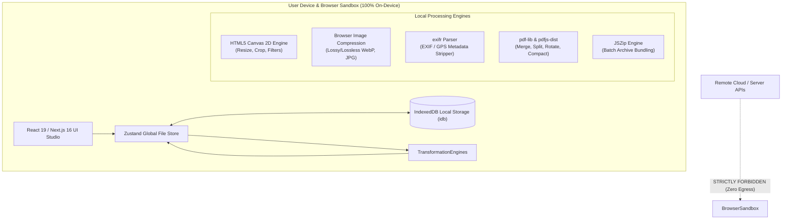

# FileFixer — Architecture & Technical Design

## 1. High-Level System Architecture

FileFixer is engineered as a **100% on-device, client-side digital utility studio** built on Next.js 16 (App Router), React 19, TypeScript, and Tailwind CSS.

Unlike traditional web-based file utilities that upload user files to remote servers for processing, FileFixer performs all transformations directly within the user's browser sandbox using client-side Web APIs, Web Workers, and WebAssembly.

---

## 2. Invariants & Security Architecture

### Zero Server Upload Invariant
FileFixer's foundational principle is **absolute privacy**:
- `src/app/api` contains strictly zero API endpoints.
- No file data or metadata is ever transmitted across the network.
- No third-party behavioral trackers (e.g., Google Analytics, Hotjar, Segment, Mixpanel) are integrated into the application.
- All file transformations execute in local browser memory and are garbage collected when the session ends or files are dismissed.

### Local-First Persistence
- **Local History**: Optimization metrics, compression ratios, and timestamps are recorded strictly on-device in browser `IndexedDB` via `idb` and `localStorage`.
- **Workspace State**: Users can manage files across multiple tools with staging state coordinated by a reactive `Zustand` store.

---

## 3. Core Processing Pipelines

### Image Studio & Optimization Pipeline
1. **Decode**: Images are loaded into in-memory `Blob` objects and decoded via the browser's native `Image` and `OffscreenCanvas` / `Canvas` context.
2. **Transform**: Rotations, flips, aspect ratio crops (`react-image-crop`), and CSS filter matrices are rendered onto memory canvases.
3. **Smart Compress**: A multi-pass binary search algorithm iteratively tests quality factors (0.1 to 1.0) and dimensions until user-specified file size ceilings (e.g. "Under 200 KB" for government portals) are achieved without unnecessary visual loss.
4. **Metadata Sanitization**: `exifr` scans for GPS coordinates, camera serial numbers, and creator tags, allowing zero-leak scrubbing before export.

### PDF Workstation Pipeline
1. **Document Loading**: Byte streams are parsed in-browser via `pdf-lib` and page viewports are previewed using `pdfjs-dist`.
2. **Page Manipulation**: Pages can be visually rearranged, rotated in 90-degree increments, extracted, or duplicated without server round-trips.
3. **Stream Compaction**: Redundant object streams, unreferenced resources, and embedded metadata dictionaries (`Author`, `Title`, `Producer`) are stripped during export.
4. **Images to PDF**: Uploaded images are mapped to standardized page formats (A4, Letter) with customizable margins and auto-orientation.

### Batch & Workflow Engine
- **Sequential Pipeline**: Processes batches of images through multi-stage pipelines (e.g., Resize $\rightarrow$ Convert to WebP $\rightarrow$ Compress $\rightarrow$ Rename) sequentially to preserve browser thread responsiveness.
- **Dynamic Renaming**: Evaluates pattern tokens (`{name}`, `{ext}`, `{n}`, `{YYYY-MM-DD}`, `{width}x{height}`) with safety checks against invalid filenames and collision resolution.
- **ZIP Packaging**: Transformed outputs are bundled locally using `jszip` for single-click archive downloads.

---

## 4. Design System & Accessibility Architecture

- **Cinematic Glass Studio**: Built with layered translucency (`backdrop-blur-xl`), luminous borders (`rgba(96, 165, 250, 0.35)`), and deep ambient navy palettes (`#070A12` / `#0B1020` in dark mode; `#F4F7FC` / `#FFFFFF` in light mode).
- **Tabular Numerics**: Universal `.tabular-nums` and `font-variant-numeric: tabular-nums` enforcement across all sizes, percentages, and metrics.
- **Mobile First Touch Bounds**: All interactive controls, tool buttons, switches, and tabs implement a minimum touch target bounding box of $\ge 44 \times 44\text{px}$ ($\ge 48\text{px}$ on the mobile bottom navigation dock).
- **WCAG AA Compliance**: High-contrast color ratios ($\ge 4.5:1$) for all text and destructive actions across both light and dark themes.
